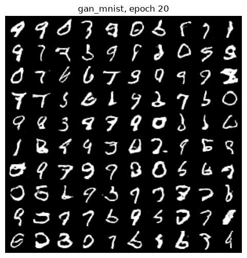
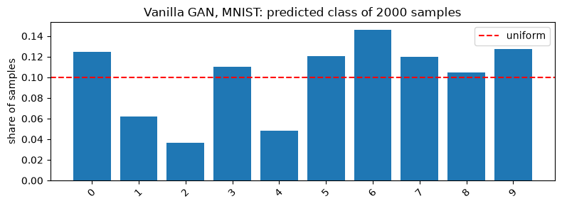
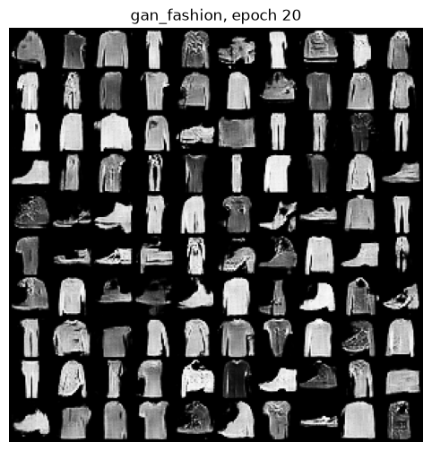
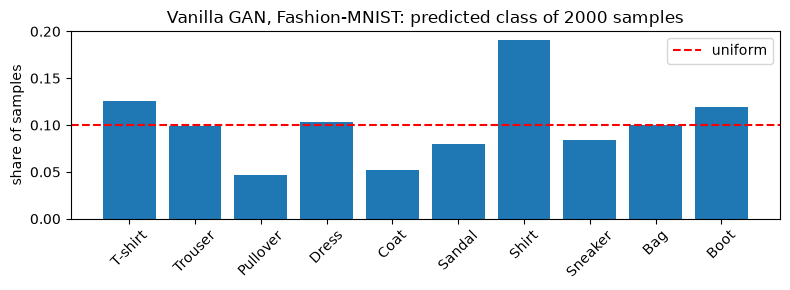
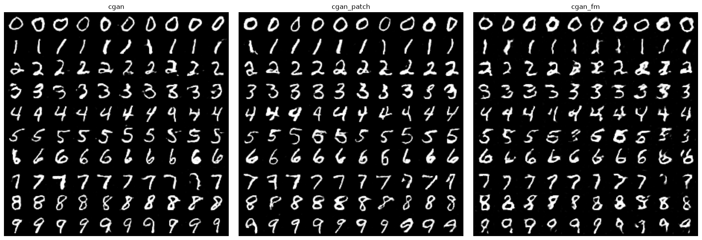
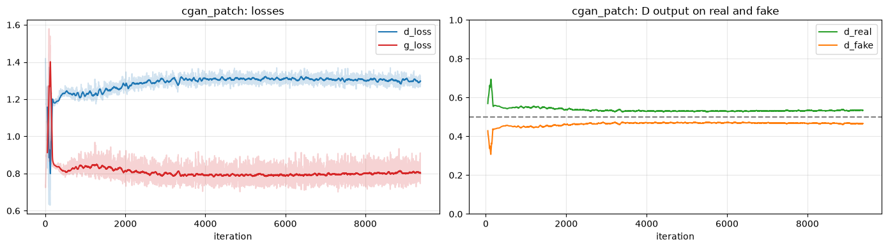
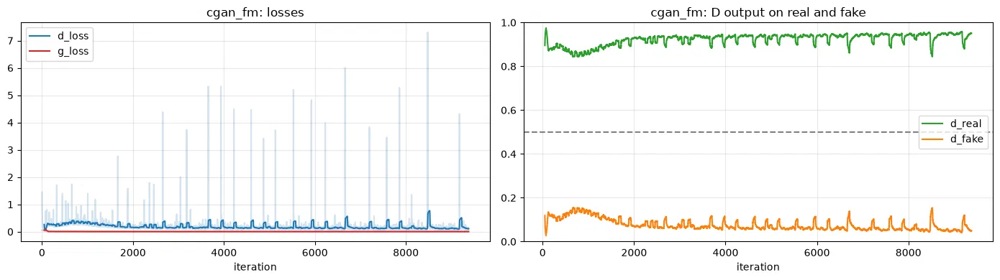

# GAN

This one is shorter than Norm Flow and VAE. The deadline was close, so I did not go through every part of GANs as thoroughly as with the previous two, and some things I understand only at a basic level

## How I understand GANs

There are two networks. The generator G takes random noise z from N(0, I) and turns it into an image. The discriminator D looks at an image and says how likely it is to be real. They are trained against each other: D learns to separate real images from fakes, and G learns to make fakes that D accepts as real.

Unlike Norm Flow and VAE, there is no likelihood here at all. G never sees the real images directly, it only learns through the feedback from D. That is why the loss values do not tell you much about quality, so instead I watched what D outputs on real and fake images (d_real and d_fake). If both go to 0.5, D can't tell them apart. If d_real stays near 1 and d_fake near 0, D is winning.

The main problem is mode collapse: G finds a few images that fool D and keeps producing only those. To check for it, I trained a simple classifier on real data and looked at which classes the generated samples fall into.

## What I did

- Vanilla GAN on MNIST and FashionMNIST (conv generator 7 - 14 - 28, conv discriminator 28 - 14 - 7), 20 epochs each
- Conditional GAN (cGAN) on MNIST: the class label is given to both G and D, so you can ask for a specific digit
- Two variations of the cGAN:
  - PatchGAN: D outputs a 7x7 grid of real/fake scores, one per patch, instead of one number for the whole image
  - Feature matching: G does not try to fool D directly, it tries to make the average features inside D match for real and fake images
- To evaluate the samples I used the classifier: confidence (how sure it is about the class), diversity, the class histogram, and for cGANs label accuracy (does the generated digit match the label we asked for)

## Results

**Vanilla GAN, MNIST** (classifier accuracy on real test data 0.975)

| | confidence | diversity |
|---|---|---|
| real data | - | 19.69 |
| GAN | 0.84 | 20.19 |

**Vanilla GAN, FashionMNIST** (classifier accuracy 0.825)

| | confidence | diversity |
|---|---|---|
| real data | - | 22.78 |
| GAN | 0.743 | 22.61 |

**Conditional GANs, MNIST**

| model | label accuracy | confidence | diversity |
|---|---|---|---|
| cGAN | 0.985 | 0.975 | 19.98 |
| cGAN + PatchGAN | 0.979 | 0.973 | 20.09 |
| cGAN + feature matching | 0.969 | 0.965 | 20.27 |

Each row is one digit label:

D outputs during training, PatchGAN and feature matching:

## Observations

- No full mode collapse, all classes are generated. But the vanilla MNIST GAN is not balanced: 1, 2 and 4 are rare (4-6% instead of 10%) and 6 is too frequent. On Fashion, shirt is overrepresented and pullover and coat are rare, but the classifier itself mixes up these classes, so this is partly the classifier's fault.
- In general GAN samples look sharper than VAE samples, but there is no number like NLL or ELBO to check if training is going well, so you have to look at the images and the D outputs all the time.
