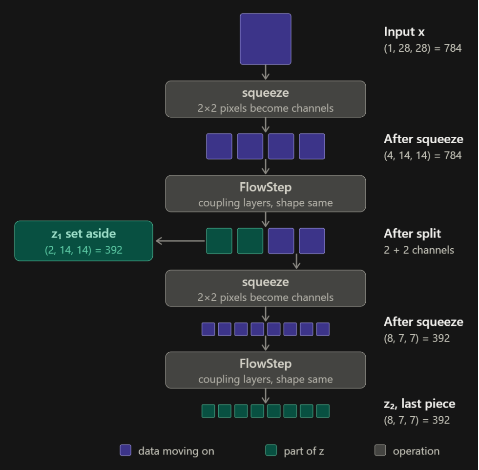
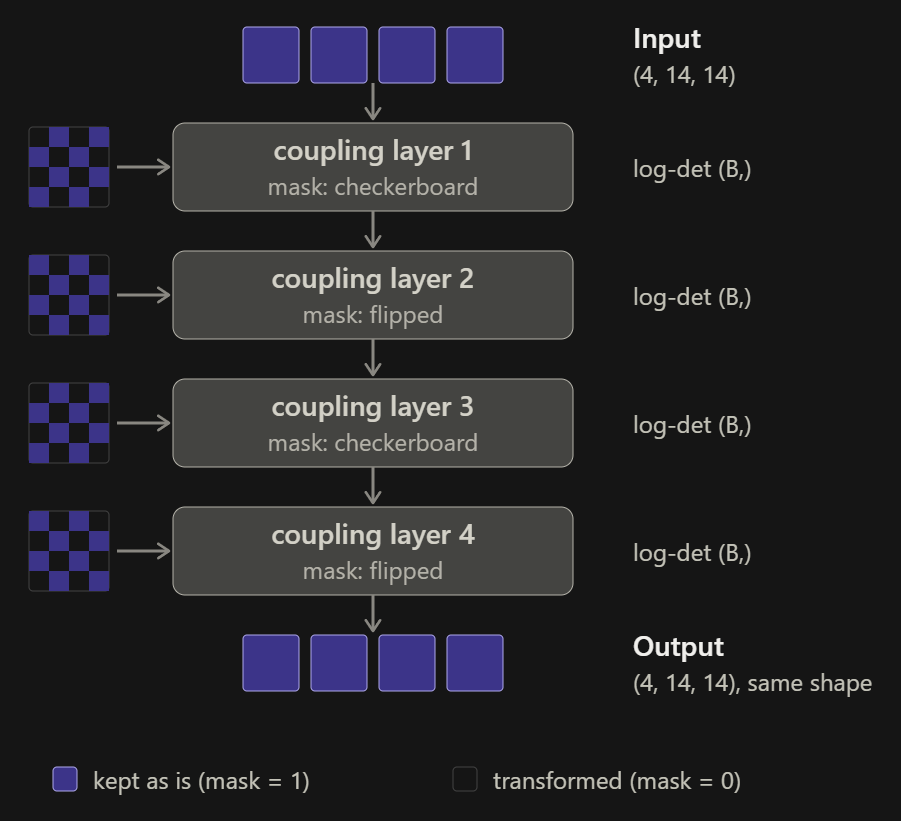
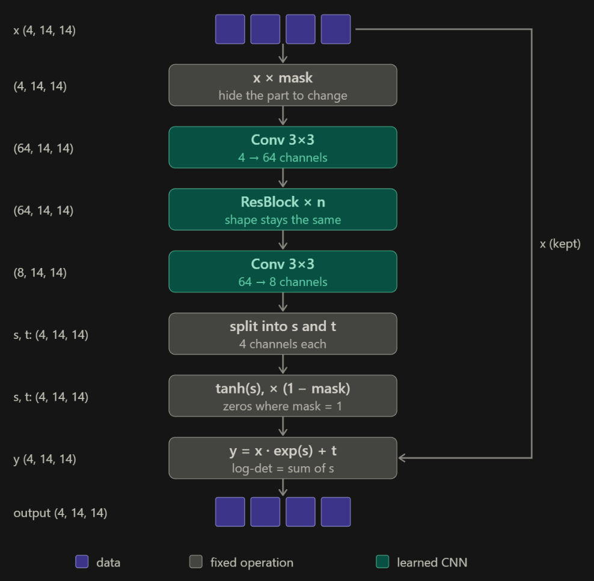

# Norm Flows: RealNVP 


## How I understand normalizing flows

The goal is to learn the distribution of the data, p(x), so that the model can both tell how likely an image is and generate new ones. The distribution of real images is too complex to write, but a standard Gaussian is easy to sample from and to evaluate.

A flow is an invertible function f that reshapes one into the other. Basically every image is a point, and all the training images together form a cloud with a strange shape (like the two moons from the tutorial). The flow bends the space so that this cloud turns into a round sphere, the standard Gaussian N(0, I), dense in the centre and sparser towards the edges. Every point gets its own place inside the sphere, so nothing is merged or lost. Because it is invertible, you can go both ways - x to z and back from z to x. by going back we take random noise from gaussian and turn in into a new image. 


An image is just a point in a 784-dimensional space (28x28), and real digits occupy a tiny, oddly shaped part of it. The latent space has the same 784 dimensions. Unlike an autoencoder, nothing is thrown away and the information is only rearranged into a different shape.

The loss is the negative log-likelihood:

```
log p(x) = log N(z) + log |det J|
```

The first term pulls z towards the centre of the Gaussian. The log-determinant is what stops the model from cheating by squeezing everything into one point. it accounts for how much the flow stretches or compresses space. The balance between the two is what makes the flow spread the data evenly over the Gaussian.

## What I did

The model has three nested levels: RealNVP contains one FlowStep per scale, and each FlowStep is a stack of CouplingLayers. The three diagrams below were made with claude and were very helpful for me when I was trying to understand the architecture.

**Multi-scale (RealNVP).** squeeze repacks every 2x2 block of pixels into 4 channels (28x28x1 → 14x14x4), a FlowStep runs on that, and then split sets half of the channels aside as part of z. The rest goes to the next scale. With 28x28 images only 2 scales are possible (28 → 14 → 7), giving z1 of shape (2, 14, 14) and z2 of shape (8, 7, 7): 392 + 392 = 784 numbers, the same as the number of pixels.



z1 is not thrown away. During training it only contributes its Gaussian log-likelihood to the loss and during generation it is sampled again and concatenated back in the inverse pass.

**FlowStep and masks.** A FlowStep is a stack of coupling layers that never changes the tensor shape. Each layer keeps one half of the values and transforms the other, and the half is chosen by a mask. IT was also important to flip masks not to miss any part of image to be transformed. 



Also it is important to mention which masks were used for that. First, the mask itself. it is a tensor of 0 and 1 with the same size as the feature map. Where the mask is 1, the value is kept as it was and is used as input for the coupling network. where the mask is 0, the value is transformed with y = x · exp(s) + t.

Inside one FlowStep the masks are:

1. Checkerboard – pixels are split like a chess board
2. Checkerboard, flipped – the same pattern with 0 and 1 swapped, so the pixels that were kept in the previous layer are now transformed.
3. Channel – the first half of the channels is kept and the second half is transformed
4. Channel, flipped – the other half of the channels is transformed.

**Coupling layer.** Half of the input is kept unchanged; a small CNN looks at that half and predicts a scale s and shift t for the other half: y = x · exp(s) + t. This is invertible because the unchanged half lets you recompute exactly the same s and t, and the log-det is simply the sum of s. 




**Dequantization.** Pixels only take 256 discrete values, while the flow models a continuous density. Without a fix the model can put infinitely sharp peaks on those 256 values and the likelihood becomes meaningless. Adding uniform noise smaller than one brightness step turns the "stairs" into a "ramp".

## Results

**First version** (checkerboard masks only, tanh limiting s to (−1, 1)):
- test NLL plateaued around −1535 after 10 epochs and −1575 after 30
- samples had the some kind of a right form but no digit shapes
- I did not save training results and too lazy to run again so will not share them here


## Observations and what I learned

**The tanh ceiling.** This was the most interesting bug. With tanh, one coupling layer can stretch a value at most exp(1) ≈ 2.7 times. After dequantization every black pixel lives in an interval of width 1/256 ≈ 0.004, and to turn that into something that looks like N(0, 1) it has to be stretched about 250 times. With only a few layers the model physically could not do it, which explains both the loss plateau and the bad samples. So I added one more learning parameter - scale. and it's purpose is to scale tanh(s). Without it, tanh keeps s between -1 and 1.
s = self.scale * torch.tanh(s_from_network)

**Checkerboard after squeeze is not enough.** After squeeze, each 2x2 block of neighbouring pixels sits in one place as 4 channels. The checkerboard mask treats all 4 channels the same way, so the whole block is always either kept or changed together. Because of that, the 4 pixels of a block never get to see each other, only at the neighbouring blocks. I think this is why the strokes in my first samples looked like broken. A channel mask fixes it because it keeps 2 of the 4 pixels and changes the other 2 based on them, so pixels inside a block finally see each other.

**CNN layers perform much better than MLP**. Inside each coupling layers I first put MLP layers. But considering this is a CV task, I tried COnv layers together with those masks described earlier. And results turned out to be much better. 

**Likelihood vs sample quality.** A flow gives an exact log-likelihood, which is its big advantage. But in my first run the NLL kept improving but the samples still looked like worms, not digits. The likelihood is mostly decided by local details (black background, strokes, neighbouring pixels being similar), and those are easier to learn than the overall shape of a digit. To get global structure the model needs enough capacity and the right design choices like masks that let the right pixels see each other, multiple scales, and enough layers.
