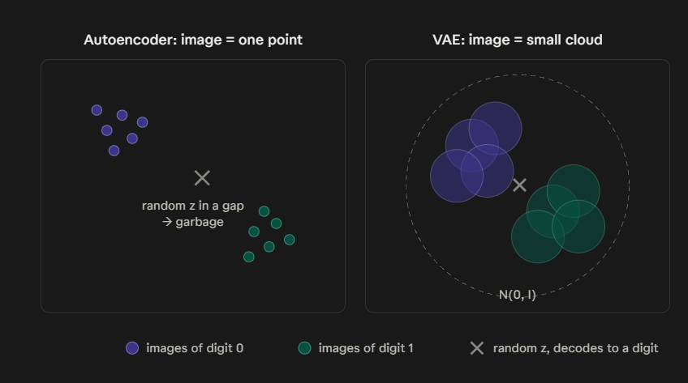
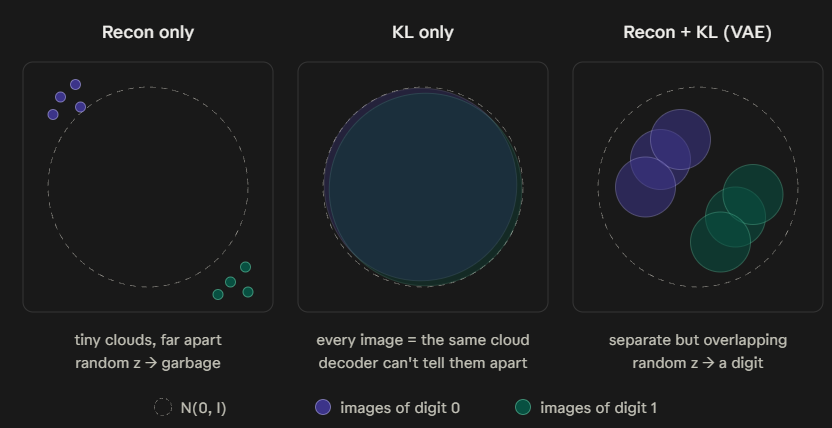
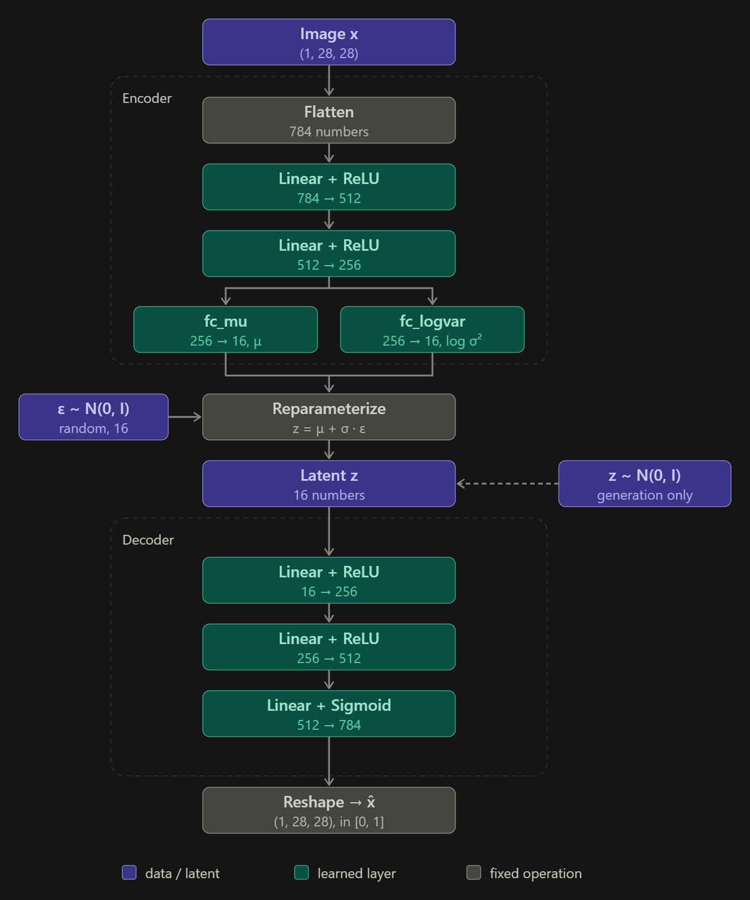
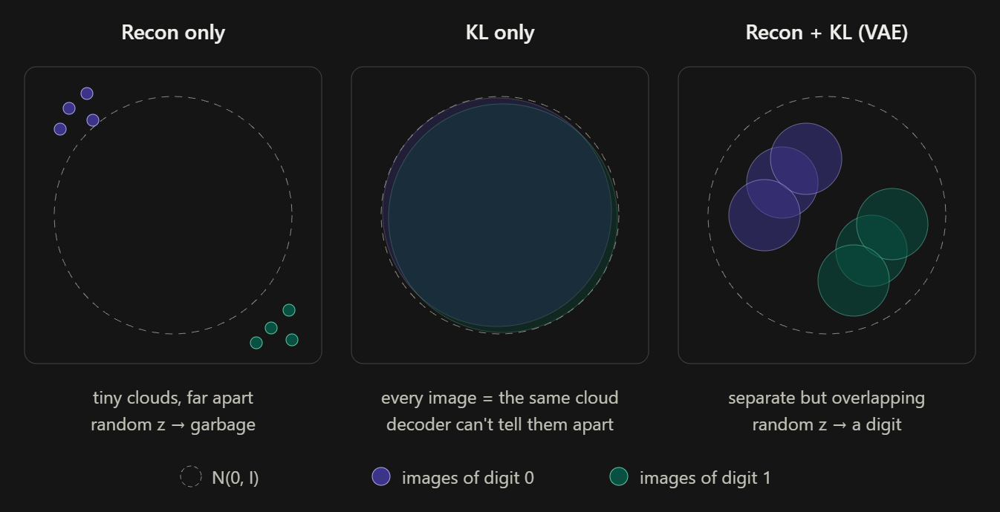
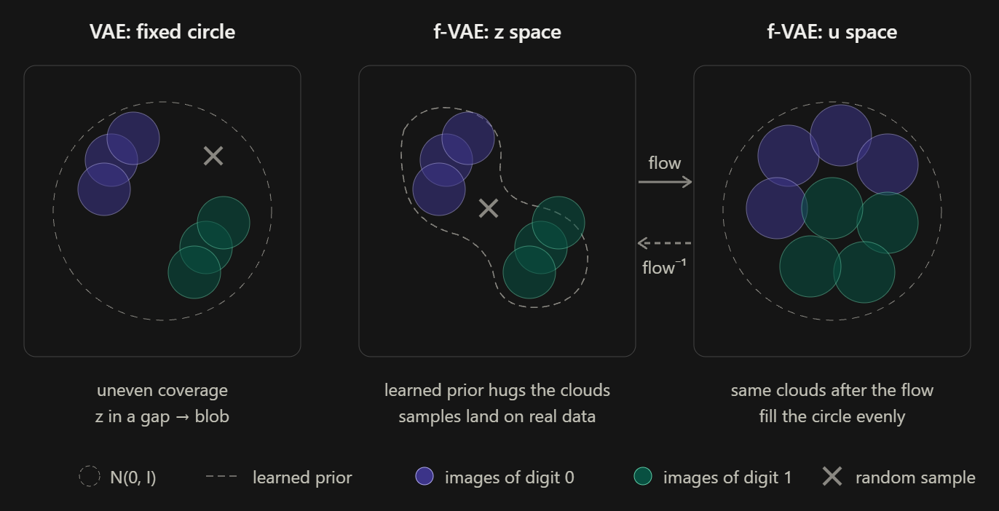
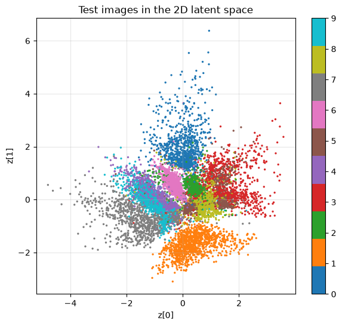

# Autoencoders, VAE, f-VAE and β-VAE

## How I understand autoencoders and VAE

An autoencoder has an encoder that squeezes an image (784 pixels) into a few numbers z, and a decoder that rebuilds the image from them. Unlike a normalizing flow, the latent space is much smaller than the image, so some information is lost on purpose. The smaller z is, the stronger the compression and the blurrier the reconstruction.

A plain autoencoder can compress, but it can't really generate. If you think of the latent space as a map, every image becomes one point on it. Points of the same digit end up close together, but there are empty gaps between the groups. Nothing in training asks the model to fill those gaps, so a random point usually lands in one and the decoder draws garbage.

again, I used a help of claude's svg diagrams to understand some stuff better

A VAE fixes this by encoding every image not as a point but as a small cloud with a centre μ and a size σ for every latent dimension. During training a random point inside the cloud is picked (z = μ + σ · ε) and the decoder has to rebuild the image from it. The loss has two parts that pull in opposite directions:

- reconstruction wants tiny clouds far from each other, so the decoder never mixes images up
- KL wants every cloud to look like the standard Gaussian N(0, I), centred at 0 with size 1

The balance between them gives clouds that fill the "circle" of N(0, I) but are still different from each other. So after training I can take a random z from N(0, I) and the decoder turns it into a sensible image. 

## What I did

All models are MLPs (784 → 512 → 256 → latent and back), trained with binary cross-entropy summed over pixels. 

**Autoencoder.** I trained one model for each latent size (2, 4, 8, 16, 32, 64) to see how compression affects reconstruction.

**VAE.** The architecture is the same as the autoencoder, the only difference is that the encoder ends with two heads, mu and logvar, instead of one. z is still what the decoder sees, mu and logvar are just the recipe for the cloud z is drawn from. For generation the encoder is skipped and z is drawn straight from N(0, I). I trained it with latent size 16 on MNIST and Fashion-MNIST, and also a separate VAE with latent size 2 just to be able to draw the latent space.

This is what each part of the loss would do on its own and together:

**f-VAE.** In a plain VAE the clouds never fill the N(0, I) circle evenly. Some areas are crowded and some are almost empty, but sampling picks points from the whole circle, so some samples land in empty areas. The f-VAE replaces the fixed circle with a learned shape. A RealNVP flow (the simple MLP version from the tutorial, 6 coupling layers) maps z to u, and only u is compared with N(0, I). Basically the VAE forces the clouds to fit the circle, and the f-VAE lets the circle bend to fit the clouds.

**β-VAE.** Same VAE, but the KL term is multiplied by β. I trained 4 models with β = 0.5, 1, 4 and 8.

## Results

**Autoencoder, test reconstruction error:**

| latent size | compression | MSE per pixel | BCE per image |
|---|---|---|---|
| 2 | 392x | 0.037 | 135 |
| 4 | 196x | 0.026 | 111 |
| 8 | 98x | 0.016 | 86 |
| 16 | 49x | 0.009 | 70.5 |
| 32 | 24.5x | 0.0066 | 63.5 |
| 64 | 12x | 0.0063 | 63.0 |

**VAE and f-VAE, latent size 16, test set:**

| dataset | model | −ELBO | reconstruction | KL |
|---|---|---|---|---|
| MNIST | VAE | 100.31 | 79.83 | 20.47 |
| MNIST | f-VAE | 98.06 | 79.25 | 18.81 |
| Fashion-MNIST | VAE | 241.11 | 228.44 | 12.67 |
| Fashion-MNIST | f-VAE | 239.01 | 227.25 | 11.76 |

**β-VAE on MNIST** (−ELBO always computed with β = 1 so the numbers can be compared):

| β | −ELBO | reconstruction | KL | active latent dims |
|---|---|---|---|---|
| 0.5 | 105.1 | 78.1 | 27.0 | 15 / 16 |
| 1 | 104.7 | 86.0 | 18.8 | 11 / 16 |
| 4 | 123.1 | 115.3 | 7.8 | 6 / 16 |
| 8 | 143.8 | 139.5 | 4.3 | 5 / 16 |

A latent dimension counts as active if its average KL is above 0.1. The inactive ones output μ = 0 and σ = 1 for every image, so they carry no information.

## Observations and what I learned

**Latent size is a trade-off.** A bigger latent is always better for reconstruction, so the question is how much compression you can afford. With d = 2 the model only keeps the rough shape and similar digits get mixed up (4s and a 5 were reconstructed as 9s). From d = 16 the reconstructions are close to the originals, and between 32 and 64 there is almost no difference. So for MNIST 16 or 32 dimensions is enough.

**VAE pays for a smooth latent space.** With the same latent size the VAE reconstructs a bit worse than the autoencoder (79.8 vs 70.5). The autoencoder gives the decoder one exact point for every image, while the VAE gives it a random point from the image's cloud, and the clouds overlap a little. So the decoder gets less precise information and the reconstructions are a bit blurrier. That is the price for filling the gaps so I can generate.

**The 2D latent map was the best proof for me.** With latent size 2 I could actually draw where the test images land. All digits are packed inside roughly −3 to 3, and decoding a grid over that area gives a map where digits turn into each other  without garbage. That is exactly the filled circle from the diagrams.

**Samples are blurry and some mixes.** Most VAE samples are recognizable digits with natural variation, but some are a mix of two digits. 

**f-VAE helps, but not that much.** It is better on every number for both datasets. KL is lower because the clouds don't have to fit a fixed circle anymore. On MNIST samples there are fewer unclear mixes, and Fashion samples are brighter and sharper. 

**β controls the balance.** A bigger β gives worse reconstructions (at β = 8, 4s and 5s become 9s), smoother but more "average" looking samples and fewer active dimensions: 15 at β = 0.5 and only 5 at β = 8. With a strong KL the model can afford only a few dimensions, so it puts the most important things into them.